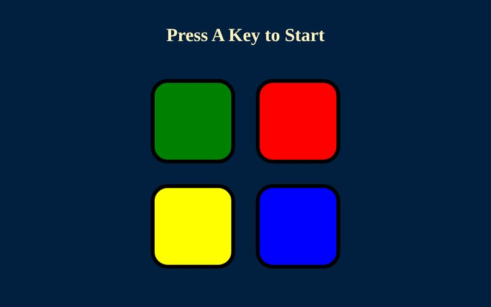
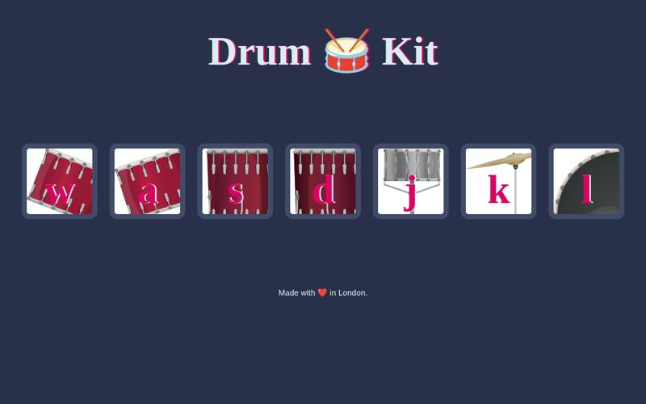
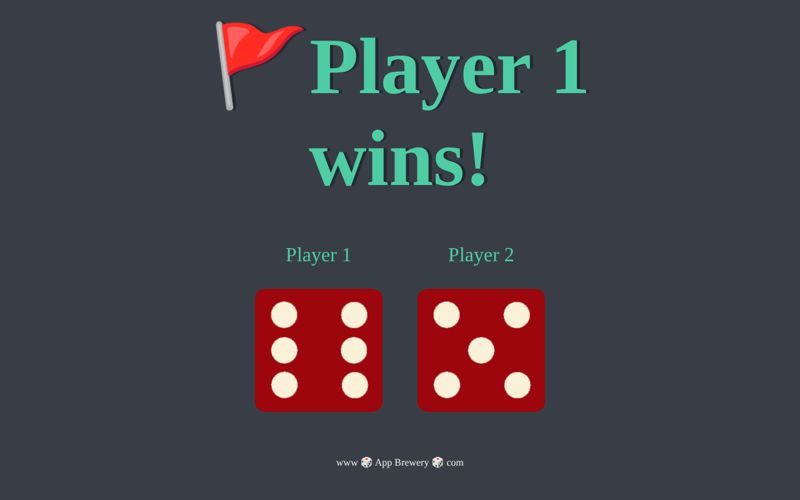
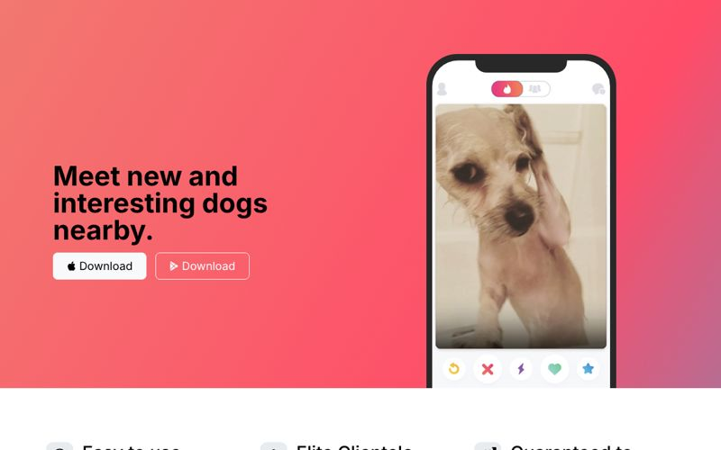
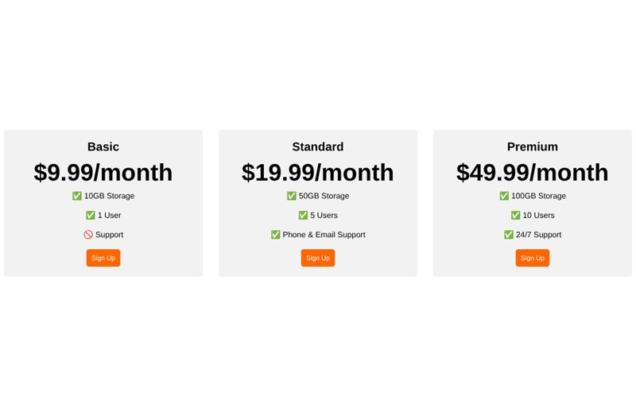
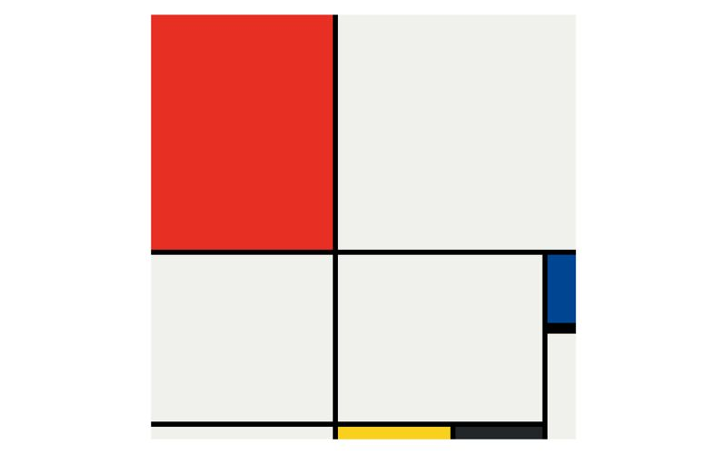
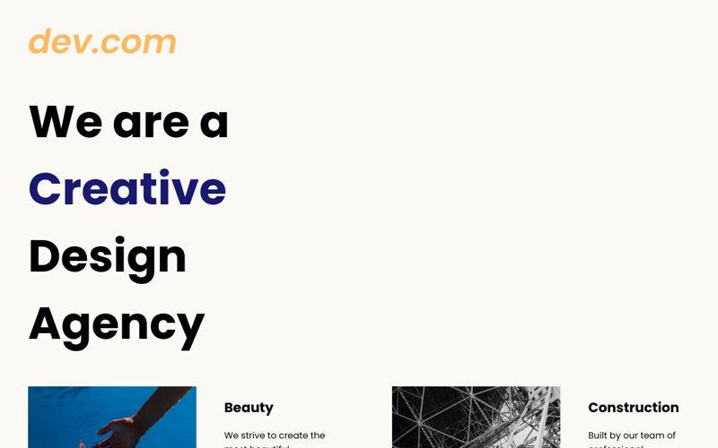
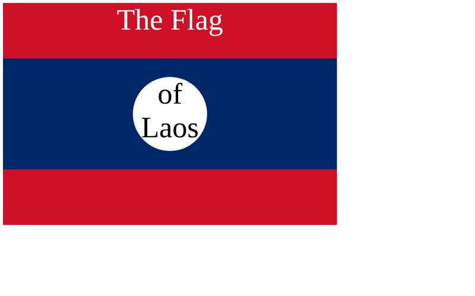

# Web Dev Small Projects

Front-end and back-end projects I built while working through **Angela Yu's _Complete Web Development Bootcamp_** (The App Brewery). The course provides the project briefs and starter assets (images and sounds); the HTML, CSS and JavaScript in this repo is my own.

**▶ Live site: [cheyennebejj123.github.io/Web-Dev-Small-Projects](https://cheyennebejj123.github.io/Web-Dev-Small-Projects/)**

**Skills:** HTML5 · CSS3 (Flexbox, Grid, media queries) · Bootstrap 5 · JavaScript (DOM, events, audio) · jQuery · Node.js · Express · EJS · npm

---

## Featured projects

| | Project | What it does | Built with | Links |
|---|---|---|---|---|
|  | **Simon Game** | Memory game: repeat a growing color sequence; sounds, animations and a game-over state | JavaScript, jQuery | [Live](https://cheyennebejj123.github.io/Web-Dev-Small-Projects/projects/simon-game/) · [Code](projects/simon-game) |
|  | **Drum Kit** | Play drums by clicking or pressing W A S D J K L, with button animations | JavaScript (DOM events, Audio) | [Live](https://cheyennebejj123.github.io/Web-Dev-Small-Projects/projects/drum-kit/) · [Code](projects/drum-kit) |
|  | **Dicee** | Two-player dice roll; refresh the page to pick a winner | JavaScript | [Live](https://cheyennebejj123.github.io/Web-Dev-Small-Projects/projects/dicee/) · [Code](projects/dicee) |
|  | **TinDog** | Multi-section landing page for a startup (hero, features, testimonials, pricing) | Bootstrap 5 | [Live](https://cheyennebejj123.github.io/Web-Dev-Small-Projects/projects/tindog/) · [Code](projects/tindog) |
|  | **Pricing Table** | Responsive three-tier pricing cards that stack on small screens | CSS Flexbox, media queries | [Live](https://cheyennebejj123.github.io/Web-Dev-Small-Projects/projects/flexbox-pricing/) · [Code](projects/flexbox-pricing) |
|  | **Mondrian** | Recreation of a Piet Mondrian painting | CSS Grid | [Live](https://cheyennebejj123.github.io/Web-Dev-Small-Projects/projects/mondrian-grid/) · [Code](projects/mondrian-grid) |
|  | **Web Design Agency** | Agency homepage with a floated layout | CSS layout, Google Fonts | [Live](https://cheyennebejj123.github.io/Web-Dev-Small-Projects/projects/web-design-agency/) · [Code](projects/web-design-agency) |
|  | **Flag of Laos** | A national flag drawn entirely in CSS | CSS positioning | [Live](https://cheyennebejj123.github.io/Web-Dev-Small-Projects/projects/css-flag/) · [Code](projects/css-flag) |

### Smaller HTML/CSS projects
- **HTML Portfolio**: multi-page site linking my early projects · [Live](https://cheyennebejj123.github.io/Web-Dev-Small-Projects/projects/html-portfolio/)
- **Movie Ranking**: my top 3 movies · [Live](https://cheyennebejj123.github.io/Web-Dev-Small-Projects/projects/movie-ranking/)
- **Birthday Invite** · [Live](https://cheyennebejj123.github.io/Web-Dev-Small-Projects/projects/birthday-invite/)
- **Color Vocab**: Spanish color flashcards · [Live](https://cheyennebejj123.github.io/Web-Dev-Small-Projects/projects/color-vocab/)
- **Motivation Meme**: CSS styling practice · [Live](https://cheyennebejj123.github.io/Web-Dev-Small-Projects/projects/motivation-meme/)

## Back-end (Node.js)

These run on a server, so they have no live link. To run one:

```bash
cd backend/<project-folder>
npm install
node index.js        # then open http://localhost:3000
```

| Project | What it does |
|---|---|
| [QR Code Generator](backend/qr-code-generator) | CLI app: asks for a URL (inquirer), turns it into a QR code PNG (qr-image) and saves the URL to a text file (fs) |
| [Express Routes](backend/express-routes) | First Express server with multiple GET routes |
| [HTTP Methods](backend/http-methods-postman) | GET / POST / PUT / PATCH / DELETE routes, tested with Postman |
| [EJS Tags](backend/ejs-tags) | Server-side rendering with EJS templates and partials |
| [npm Packages](backend/npm-packages) | Using third-party npm packages with ES modules |

## Lesson exercises

The [`lessons/`](lessons) folder holds the short exercises from each topic, numbered by course section: HTML elements, CSS selectors, the box model, positioning, display and float, Flexbox, Grid, responsiveness, Bootstrap and jQuery. These are practice files, not stand-alone projects.

## Run locally

Front-end projects need no build step. Clone the repo and open any `index.html` in your browser.

```bash
git clone https://github.com/cheyennebejj123/Web-Dev-Small-Projects.git
```
